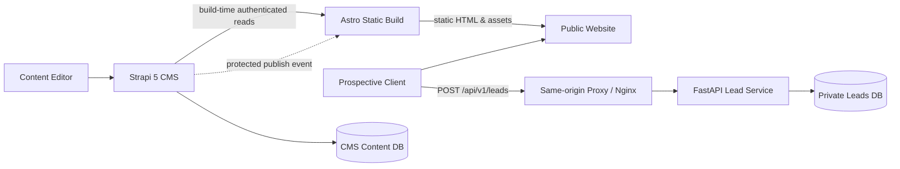

# LeadForge

**An SEO-first agency website and private lead-intake platform.**

The public-facing demo brand is **Forma Studio**, an independent digital experience consultancy. Demo content and case studies are explicitly fictional demonstration assets.

---

## 1. System Overview

| Concern | Implementation | Status |
|---|---|---|
| **Public Website** | Astro 5.18 + TypeScript, static generation, SEO metadata, Tailwind CSS | Verified (`npm run build` generates 11 pages) |
| **Content Operations** | Strapi 5, draft/publish editorial content model | Implemented schema & seed fixtures |
| **Lead Capture** | Python 3.12 + FastAPI 0.143, Pydantic 2, anti-abuse controls | Verified (14/14 Pytest tests passing) |
| **Persistence** | PostgreSQL 16/17; separate `leadforge_cms` and `leadforge_app` databases | Verified & migrated via Alembic |
| **Data Ingestion** | Same-origin `/api/v1/leads` reverse-proxied to FastAPI | Verified end-to-end |
| **Visual System** | Ink (`#171717`) and Paper (`#F7F6F2`); Inter typography, quiet confidence | Strict two-color compliance |

---

## 2. Architecture & Flow



### Trust & Isolation Boundaries
- **No Public Lead Reads:** There is no `GET /api/v1/leads` endpoint. Prospective client records are never returned to browsers.
- **Database Separation:** The CMS database (`leadforge_cms`) and the leads database (`leadforge_app`) have independent credentials and cannot access each other's tables.
- **Build Isolation:** The Astro frontend build reads published content at build time. No Strapi admin credentials or database secrets are included in client bundles.

---

## 3. Verified Environment & Toolchain

The following versions are tested and verified on the local host and container images:
- **Node.js:** `v22.12.0` (LTS)
- **npm:** `11.6.2`
- **Astro:** `5.18.2`
- **Python:** `3.12.10`
- **uv:** `0.13.0`
- **FastAPI:** `0.143.0`
- **SQLAlchemy:** `2.1.4`
- **Alembic:** `1.20.0`
- **PostgreSQL:** `16-alpine` (Docker) / `17.5` (Host)

---

## 4. Local Quickstart Runbook

### Step 1: Environment Setup
Copy the example environment template:
```bash
cp .env.example .env
```

### Step 2: Database Initialization
Ensure PostgreSQL is running, then run the database and role bootstrap script:
```bash
psql -U postgres -h localhost -f infra/postgres/init/01-init.sql
```

### Step 3: Run Database Migrations
Set up Python environment and apply Alembic migrations for `leadforge_app`:
```bash
cd api
py -3.12 -m uv venv .venv
.\.venv\Scripts\activate
py -3.12 -m uv pip install -e ".[dev]"
.\.venv\Scripts\alembic upgrade head
```

### Step 4: Run API Tests
Execute unit and integration tests:
```bash
.\.venv\Scripts\pytest -v
```

### Step 5: Build and Run Frontend
Install frontend dependencies and build static assets:
```bash
cd ../frontend
npm install
npm run build
npm run preview
```

The static website will be available at `http://127.0.0.1:8080`.

---

## 5. API Endpoints

| Method | Path | Description | Access |
|---|---|---|---|
| `POST` | `/api/v1/leads` | Submits a new inquiry (validates name, email, message; honeypot protected) | Public |
| `GET` | `/health/live` | Process liveness check | Public |
| `GET` | `/health/ready` | Database connectivity readiness check | Public |

### Lead Ingestion Payload Example
```json
{
  "name": "Alex Mercer",
  "email": "alex@example.com",
  "service_slug": "digital-experience-platforms",
  "message": "We need an editorial, search-optimized web architecture.",
  "website": ""
}
```

---

## 6. Verification & Quality Gates

All milestones M0 through M6 have been completed and verified. See the full audit trail:
- [`docs/Verification_evidence.md`](docs/Verification_evidence.md) — Comprehensive evidence matrix for gates G0 through G6 and tests T-01 through T-16.
- [`docs/Implementation_decision_log.md`](docs/Implementation_decision_log.md) — Architecture and dependency decisions.
- [`docs/Build_Prompt.md`](docs/Build_Prompt.md) — Autonomous coding agent specification.
- [`TODO.md`](TODO.md) — Milestone completion checklist.

---

*LeadForge is an independent portfolio architecture; Forma Studio is a fictional demo identity. No real customer relationships or performance claims are implied.*
