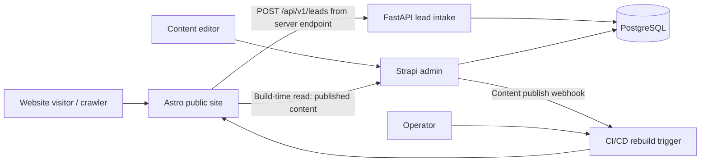
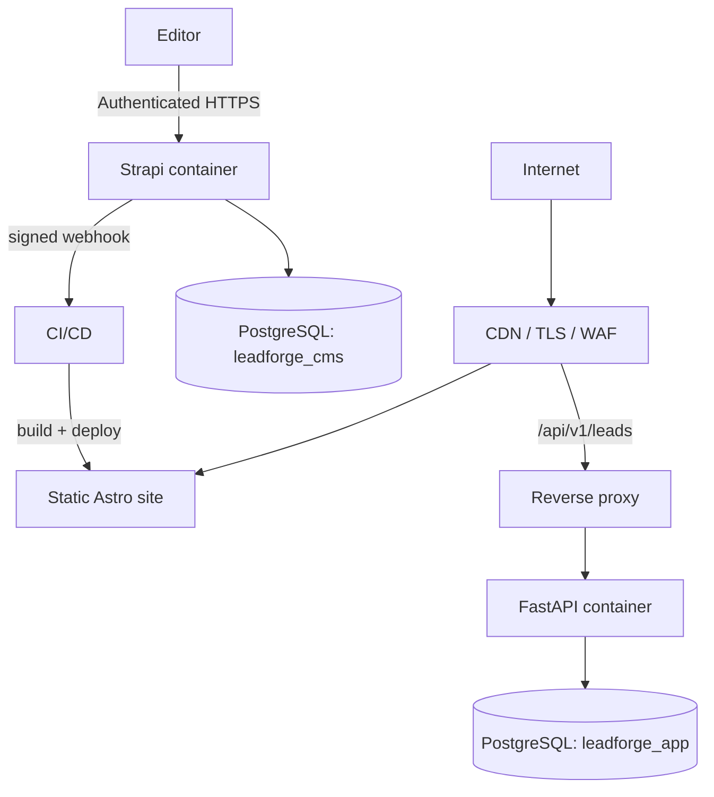

# LeadForge — System Architecture

**Status:** Proposed / Architecture baseline v1.0  
**Project:** SEO-Optimized Lead Generation Platform  
**Scope:** Single-business MVP, extensible to multiple client websites later  
**Primary stack:** Astro, Strapi, FastAPI, PostgreSQL, Docker Compose

## 1. Architecture goals

LeadForge is a fast, search-engine-friendly business website with editable service pages, case studies, testimonials, and a lead capture form. Its value proposition is enabling a digital agency to ship and maintain conversion-focused client sites without hardcoding content or building a custom admin dashboard.

Architecture priorities, in order:
1. Fast public pages, accessible UX, metadata and crawlability.
2. Simple editorial workflow through Strapi.
3. Secure and reliable lead intake without exposing customer data.
4. Reproducible local setup, automated tests, and straightforward deployment.
5. Clear boundaries that can be explained in a technical interview.

**Non-goals for MVP:** multi-tenancy, visual drag-and-drop page builder, user-facing accounts, payment processing, automated AI content generation, CRM integrations, distributed queues, analytics platform.

## 2. System context



**Trust boundaries:** Visitors can read public pages and submit leads; editors authenticate to Strapi; only server-side components hold Strapi read tokens or backend credentials. Public users never have direct database access.

## 3. Component responsibilities

| Component | Responsibility | Explicitly not responsible for |
|---|---|---|
| Astro (`frontend/`) | Static pages, dynamic routes at build time, metadata, sitemap, accessible lead form, lightweight server-side submission endpoint | CMS admin, direct DB writes |
| Strapi (`cms/`) | Content types, editorial workflow, media, published-content REST API, webhook on publication | Lead processing, rate limiting |
| FastAPI (`api/`) | Validate lead payload, abuse protection, persistence, health/readiness endpoints | Public content rendering, CMS editing |
| PostgreSQL (`db`) | Persistent Strapi data and lead data in separate schemas/databases and credentials | Public API |
| Docker Compose (`infra/`) | Local orchestration, environment configuration, health checks | Production-scale orchestration |
| GitHub Actions | Lint/test/build, deployment gate, controlled rebuild on publish | Secrets in source control |

### 3.1 Data ownership

Use one PostgreSQL server for MVP but **two logical databases** with separate least-privilege users:
- `leadforge_cms`: exclusively managed by Strapi migrations/schema synchronization.
- `leadforge_app`: exclusively managed by FastAPI + Alembic migrations.

FastAPI never reads or writes Strapi internal tables. Strapi never queries lead tables. The public Astro website fetches published content from Strapi and sends leads to FastAPI through a server-side endpoint.

## 4. Core user journeys

### 4.1 Content publication
1. Editor logs into Strapi admin and creates/updates a Service, CaseStudy, Testimonial, or SiteSettings entry.
2. Editor saves a draft and publishes it.
3. Strapi webhook notifies a **protected** CI/CD endpoint; its secret is validated and repeated events are coalesced when supported.
4. CI/CD rebuilds Astro static pages using the Strapi published-content API and deploys the resulting assets.
5. CDN cache is refreshed or invalidated as required. If rebuild fails, previous deployed site remains active and the editor is alerted.

**Consistency model:** eventual consistency between Strapi publish and public site; publishing does not guarantee instantaneous visibility.

### 4.2 Visitor lead submission
1. Visitor fills out an accessible form on an Astro page.
2. Browser sends form to an Astro server endpoint `/api/leads` (requires an Astro server adapter / hybrid or server output for this endpoint), or to a dedicated same-origin reverse-proxied API path. **Selected MVP:** reverse proxy `/api/v1/leads` to FastAPI under the same public domain; the rest of Astro is static.
3. FastAPI validates payload with Pydantic, enforces request size and rate limits, checks a honeypot field, and stores lead in `leadforge_app`.
4. API returns a generic success response; form displays confirmation and never reveals lead records.
5. Operators review leads through a protected backend workflow (MVP: authorized database/CLI export). A custom leads dashboard is deferred.

**Security:** Do not make the Strapi Lead collection public; lead records belong to FastAPI's database. Server-side rate limiting should work across workers (e.g., reverse-proxy limit or shared store); in-memory-only counters are acceptable for local demo but not multi-replica production.

## 5. Content model (conceptual)

| Model | Key fields | Notes |
|---|---|---|
| SiteSettings (single type) | brandName, logo, contactEmail, defaultSeo, socialLinks | One business per deployment |
| Service (collection) | title, slug (unique), summary, body, heroImage, seo, publishedAt | `/services/[slug]` |
| CaseStudy (collection) | title, slug (unique), clientLabel, challenge, solution, outcomes, coverImage, publishedAt | `/case-studies/[slug]`; outcomes must be factual |
| Testimonial (collection) | authorName, role, company, quote, relatedService, publishedAt | Editorial approval required |
| Lead (FastAPI-owned) | id, name, email, serviceSlug, message, status, createdAt | Private; not a Strapi content type |

Reusable Strapi components: `shared.seo` (title, description, ogImage) and `shared.cta` (label, href). Keep relationships limited to `Testimonial -> Service` and optionally `CaseStudy -> Service`.

## 6. API contracts

### 6.1 Content read (Strapi REST)
- `GET /api/site-setting` (exact route may reflect Strapi pluralization/configuration)
- `GET /api/services?filters[slug][$eq]=...&populate=...`
- `GET /api/case-studies?...`
- `GET /api/testimonials?...`

Astro fetches at build time with a **read-only** token supplied through build secrets. Prefer explicit field selection and `populate` rules. Never bundle token into client-side JavaScript. Apply Strapi public role permissions conservatively; disable unnecessary endpoints.

### 6.2 Lead intake (FastAPI)
`POST /api/v1/leads`

Request:
```json
{
  "name": "Jane Doe",
  "email": "jane@example.com",
  "service_slug": "seo-optimization",
  "message": "I need a website audit.",
  "website": ""
}
```

`website` is a honeypot field. Responses: `201` accepted, `422` validation error, `429` rate limited, `503` temporarily unavailable. Avoid returning submitted PII. Add `GET /health/live` and `GET /health/ready` (the latter verifies database connectivity).

Validation: bounded string lengths, valid email, sanitized output, parameterized queries, explicit CORS/same-origin policy, safe error logging. CAPTCHA can be added if spam persists. Honeypot is not a sufficient standalone spam defense.

## 7. Rendering and SEO strategy

- Astro static output for home, about, services index/detail, case studies index/detail, and contact page.
- Use `getStaticPaths()` for slug-based pages. Missing/unpublished entries must not be generated.
- Semantic HTML, responsive images, descriptive alt text, canonical URLs, unique titles/descriptions, Open Graph tags, `robots.txt`, and XML sitemap.
- Avoid unnecessary client hydration; use plain HTML forms and minimal JavaScript for progressive enhancement.
- Build-time fetch failures should fail the build rather than silently publish incomplete pages; retain last known-good deployment.
- Content changes become public after successful rebuild. This is intentionally simpler than SSR with runtime Strapi dependencies.

## 8. Deployment topology



**Local:** Docker Compose for Strapi, FastAPI, PostgreSQL; Astro development server may run in a container or on host. Seed demo content via documented script.

**Production MVP:** static Astro frontend on a static host/CDN; Strapi and FastAPI as separate container services behind HTTPS reverse proxy; managed PostgreSQL or backed-up self-hosted instance. Use a dedicated admin hostname for Strapi with access restrictions. Strapi media requires durable storage (persistent volume for MVP, object storage later). A static hosting platform must support proxy routing or the reverse proxy must provide same-origin `/api` access.

## 9. Security and privacy controls

- Secrets from environment/secret store; `.env.example` contains placeholders only.
- Separate DB credentials and network boundaries; PostgreSQL not internet-exposed.
- Strapi admin protected with strong credentials; restrict access where practical.
- Strapi published-content API uses minimal permissions and read-only token.
- HTTPS, security headers, upload restrictions, input validation, and rate limiting.
- Avoid sensitive PII in logs and error responses; define lead retention and deletion process.
- Webhook authenticity validation and CI/CD secret isolation; never accept unauthenticated rebuild requests.
- Dependency scanning, image scanning, and routine backups with restore tests.
- Add explicit privacy notice and consent wording appropriate to deployment jurisdiction.

## 10. Observability and reliability

- Structured JSON application logs with request ID, status, duration, and no raw lead message/email.
- Health endpoints, container health checks, error alerting, basic request metrics.
- Database migrations via Alembic for FastAPI; Strapi schema changes are versioned and deployed in a controlled order.
- Backups for both databases and Strapi media; test restoration periodically.
- Fail-safe deployment: CI only promotes successful build/tests; retain last known-good static site.

## 11. Testing and quality gates

- **Astro:** build smoke test, broken internal link check, metadata checks, accessibility checks, responsive verification.
- **Strapi:** content model and permission checks, published vs draft visibility, webhook verification.
- **FastAPI:** pytest for validation, lead persistence, duplicate/spam handling, rate limiting, error paths.
- **Integration:** seed Strapi -> Astro build -> verify pages; form submit -> FastAPI -> DB -> confirmation.
- **Infrastructure:** `docker compose config`, service health checks, migrations, basic deployment smoke test.
- **CI:** lint, typecheck, tests, builds, container checks; block deployment on failure.

## 12. Architectural decisions (ADRs)

| ID | Decision | Rationale | Trade-off |
|---|---|---|---|
| ADR-001 | Astro static generation | Fast, SEO-oriented public site | Publish requires rebuild |
| ADR-002 | Strapi for content only | Native editorial UI and REST API | Additional service to operate |
| ADR-003 | FastAPI owns leads | Demonstrates backend, clear security boundary | More components than CMS-only form |
| ADR-004 | One PostgreSQL server, two logical DBs | Isolation without infrastructure sprawl | Shared database host availability |
| ADR-005 | No custom admin dashboard in MVP | Focus on user value and speed | Lead review is operator-only initially |
| ADR-006 | Same-origin reverse proxy for lead endpoint | Simplifies browser security and CORS | Requires routing support |
| ADR-007 | Single-business deployment | Faster MVP, simpler data model | Multi-client scaling requires future design |

## 13. Repository boundaries

```text
leadforge/
├── docs/
│   ├── Architecture.md
│   ├── Build_Prompt.md
│   ├── Design.md
│   ├── ERD.md
│   ├── PRD.md
│   ├── Stack.md
│   ├── TDD.md
│   └── Implementation_plan.md
├── README.md
├── frontend/                # Astro + TypeScript
├── cms/                     # Strapi
├── api/                     # FastAPI + SQLAlchemy + Alembic
├── infra/                   # Docker Compose, reverse proxy, deployment
├── .github/workflows/
└── .env.example
```

## 14. Implementation phases (high-level)

1. Bootstrap repository, environment, PostgreSQL and Docker Compose.
2. Define Strapi types, permissions, content seed, and API queries.
3. Build Astro layout, static routes, SEO, and responsive components.
4. Implement FastAPI lead endpoint, persistence, validation, and abuse controls.
5. Connect lead form, publish webhook, and build-time content fetch.
6. Add tests, CI/CD, deployment, backups, and documentation.

Detailed acceptance criteria and task sequencing belong in `PRD.md`, `TDD.md`, and `Implementation_plan.md`.

## 15. Open decisions to resolve in later docs

- Hosting provider and whether a reverse proxy is available for same-origin lead intake.
- Strapi major version and compatible Node.js runtime; lock versions in `Stack.md`.
- Media storage choice and backup policy.
- Lead retention policy and notification channel.
- Target industry and visual identity, to be decided in `Design.md`.

**Architecture acceptance criteria:** All public content is CMS-editable; published content renders as crawlable static HTML; a visitor can submit a lead without direct CMS/DB access; lead data is private; local stack starts reproducibly; CI builds and tests reliably; deployment rollback retains the last working website.
