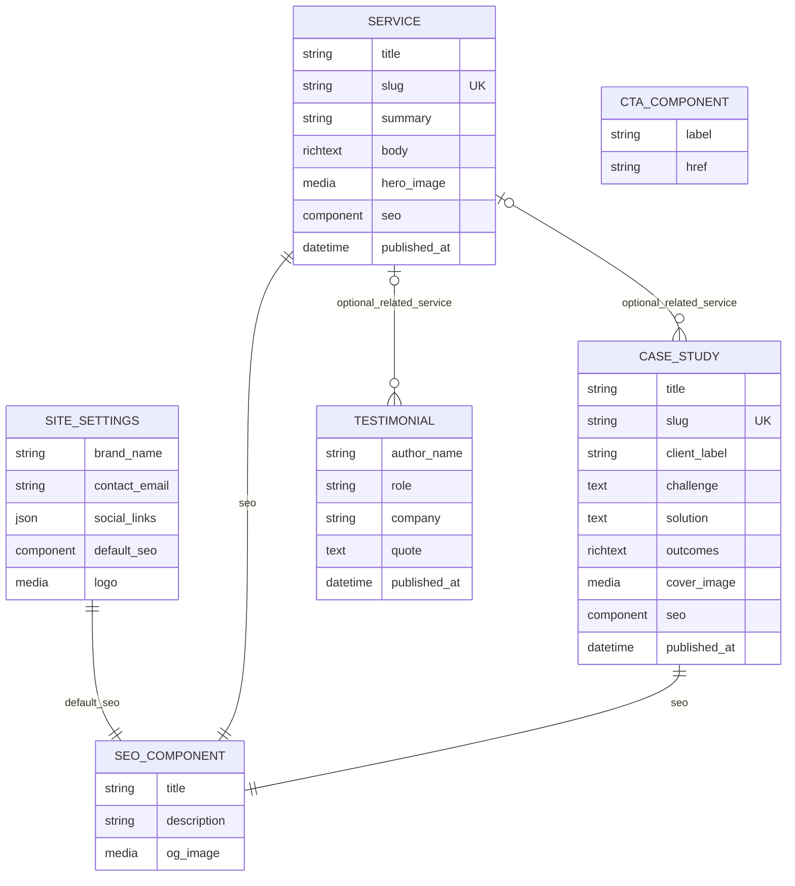
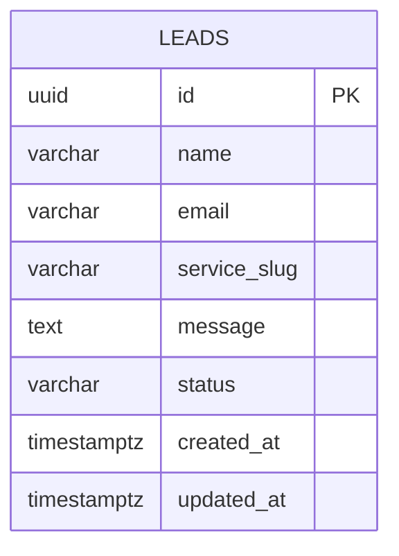

# LeadForge — Entity Relationship & Data Model (ERD)

**Version:** 1.0  
**Status:** Approved design baseline (implementation pending)  
**Depends on:** `Architecture.md` v1.0 and `PRD.md` v1.0  
**Scope:** One business per deployment; public marketing content and private lead intake.

## 1. Data ownership and database boundaries

A single PostgreSQL instance hosts **two separate logical databases with distinct least-privilege credentials**:

| Database | Owner | Data | Schema authority |
|---|---|---|---|
| `leadforge_cms` | Strapi | Site settings, services, case studies, testimonials, uploaded media, editorial metadata | Strapi content-type definitions and its internal schema management |
| `leadforge_app` | FastAPI | Private inbound leads and their lifecycle | SQLAlchemy models + Alembic migrations |

There are **no cross-database foreign keys, joins, or direct queries** between applications. Astro consumes only published Strapi content at build time. FastAPI stores leads independently. `service_slug` on a lead is a *snapshot of the selected public service slug*, not a foreign key. It may remain valid after a service is renamed or unpublished.

> Strapi generates and owns physical SQL tables, join tables, component tables, media tables, and its internal publication metadata. The CMS ERD below is a **logical content model**, not a prescription to manually create or migrate Strapi SQL tables. Inspect generated schema after locking Strapi's major version in `Stack.md`.

## 2. Logical ERD — CMS (Strapi)



**Diagram notation:** `SEO_COMPONENT` and `CTA_COMPONENT` are Strapi reusable components (not independently addressable collection types). `CTA_COMPONENT` is available for optional page composition; MVP does not require any entity to reference it. Relationship cardinalities are logical: each testimonial/case study may reference zero or one service; each service may have many of either. The `SITE_SETTINGS` single type has one logical record per deployment. Actual Strapi media/component storage uses Strapi-managed relations.

## 3. Strapi content-type contracts

### 3.1 `SiteSettings` — single type

| Field | Strapi type | Rules |
|---|---|---|
| `brandName` | string | Required; 2–100 chars |
| `logo` | media (single image) | Optional; image only |
| `contactEmail` | email | Required; public business address |
| `defaultSeo` | component `shared.seo` | Required |
| `socialLinks` | JSON | Optional; array of `{label, url}` validated in app/seed code |

### 3.2 `Service` — collection type

| Field | Strapi type | Rules |
|---|---|---|
| `title` | string | Required; 3–120 chars |
| `slug` | UID based on title | Required; unique; stable public route |
| `summary` | text (short) | Required; max 300 chars |
| `body` | rich text / blocks | Required; render safely in Astro |
| `heroImage` | media (single image) | Optional |
| `seo` | component `shared.seo` | Required |
| `publishedAt` | Strapi Draft & Publish | Only published content is publicly rendered |

### 3.3 `CaseStudy` — collection type

| Field | Strapi type | Rules |
|---|---|---|
| `title` | string | Required; 3–150 chars |
| `slug` | UID | Required; unique |
| `clientLabel` | string | Required; use fictional label in demo |
| `challenge` | text | Required |
| `solution` | text | Required |
| `outcomes` | rich text / blocks | Required; no unverified metrics |
| `coverImage` | media (single image) | Optional |
| `seo` | component `shared.seo` | Required |
| `relatedService` | relation many-to-one → Service | Optional |
| `publishedAt` | Draft & Publish | Published only |

### 3.4 `Testimonial` — collection type

| Field | Strapi type | Rules |
|---|---|---|
| `authorName` | string | Required |
| `role` | string | Optional |
| `company` | string | Optional |
| `quote` | text | Required; 10–1000 chars |
| `relatedService` | relation many-to-one → Service | Optional |
| `publishedAt` | Draft & Publish | Editor publishes only after approval/permission |

### 3.5 Reusable components

- `shared.seo`: `title` (required, max 70), `description` (required, max 160), `ogImage` (optional single image). Character limits are editorial guidance/validation targets, not search-engine guarantees.
- `shared.cta`: `label` (required), `href` (required). Validate URL scheme and prevent unsafe destinations when rendered.

**Important:** For Strapi versions using `documentId`, Astro should use `slug` for public routes and treat Strapi's document identifiers as opaque. `publishedAt` is platform-managed, not an independently edited business field.

## 4. Physical ERD — private FastAPI database



### 4.1 `leads` table specification

| Column | PostgreSQL type | Null | Default / constraint |
|---|---|---|---|
| `id` | `uuid` | No | PK; generated by application (`uuid4`) |
| `name` | `varchar(120)` | No | Trimmed; length 2–120 |
| `email` | `varchar(254)` | No | Email validated by Pydantic; normalize domain, preserve valid local part |
| `service_slug` | `varchar(120)` | Yes | Selected service slug, snapshot only |
| `message` | `text` | No | Trimmed; length 10–5000 |
| `status` | `varchar(20)` | No | Default `'new'`; CHECK in `('new','contacted','closed')` |
| `created_at` | `timestamptz` | No | `now()` in UTC semantics |
| `updated_at` | `timestamptz` | No | `now()`; updated by application on status changes |

No public `GET /leads` route. A lead is created only by `POST /api/v1/leads`; status transitions are operator-only and may initially be performed via an authenticated CLI/admin script. **Do not persist the honeypot `website` field.**

### 4.2 Index strategy

- Primary-key B-tree index on `id` (automatic).
- `CREATE INDEX ix_leads_created_at ON leads (created_at DESC);` for recent-lead export and retention operations.
- `CREATE INDEX ix_leads_status_created_at ON leads (status, created_at DESC);` only if operator status-filter queries are implemented; avoid premature indexing for the MVP.
- No index on `email` unless a concrete lookup requirement arises. No unique email constraint: one prospect can submit multiple legitimate inquiries.

### 4.3 Example Alembic migration outline

```python
# Illustrative only: implement using Alembic op.create_table and op.create_index.
# UUID generated by Python; timestamps supplied by database defaults.
# status CHECK: status IN ('new', 'contacted', 'closed')
# Index: leads(created_at DESC)
```

The production migration is generated and reviewed in `api/alembic/versions/`. Do not use `create_all()` as the production migration mechanism.

## 5. API-to-data mapping

| Operation | Source | Data action | Authorization |
|---|---|---|---|
| Astro build: `/services/[slug]` | Strapi `Service` | Read published documents | Server-side read-only token |
| Astro build: `/case-studies/[slug]` | Strapi `CaseStudy` | Read published documents | Server-side read-only token |
| Astro build: homepage | Strapi `SiteSettings`, `Service`, `Testimonial` | Read published documents | Server-side read-only token |
| `POST /api/v1/leads` | FastAPI | Validate + insert into `leadforge_app.leads` | Public, throttled, honeypot checked |
| Operator export/status | FastAPI CLI | Read/update private lead rows | Operator credentials only |

The `POST` endpoint returns `201` with a generic acknowledgment and an opaque ID at most; never echo email/message. Reject oversized or invalid input with `422`, rate-limited requests with `429`, and unavailable database with `503`.

## 6. Integrity, privacy, and lifecycle

1. **Content integrity:** Unique service/case-study slugs; stable URLs; no published draft content in Astro builds. Validate all URLs and rich text before rendering.
2. **Relationship deletion:** Prefer unpublish/archive instead of hard delete when public URLs or testimonials refer to a service. Document Strapi relation deletion behavior during integration tests; do not assume cascade semantics.
3. **Lead integrity:** Use database CHECK and NOT NULL constraints in addition to Pydantic validation. Keep all writes transactional.
4. **PII security:** Do not log names, emails, or messages. No public Strapi lead collection. Database users have no cross-database access; TLS for deployed database connections where supported.
5. **Retention:** Product owner must choose a retention period before real-world launch (open decision in PRD). MVP demo uses synthetic leads and supports manual deletion/export.
6. **Backups:** Back up both databases and Strapi media; verify restoration in a staging environment.
7. **Idempotency:** Network retries may create duplicate submissions in MVP; do not claim exactly-once behavior. Add idempotency keys only when needed.

## 7. Seeds and fixtures

- CMS: 1 site setting, 3 services, 2 fictional case studies, 2 explicitly fictional testimonials. All publication states tested (published and draft).
- FastAPI: synthetic leads only; test statuses `new`, `contacted`, and `closed`; verify duplicate email is allowed.
- No real names, email addresses, client logos, or performance claims without permission.

## 8. ERD acceptance criteria

- [ ] Strapi content types match the logical fields and relationships above.
- [ ] Astro generates routes only for published service/case-study slugs.
- [ ] Strapi API token cannot write content and is absent from client bundles.
- [ ] FastAPI migration creates `leads` with constraints and required index.
- [ ] Public lead submissions cannot read/list private lead records.
- [ ] `service_slug` remains a valid snapshot even if the corresponding CMS service is unpublished.
- [ ] Two database credentials cannot access each other's database.
- [ ] Seed and integration tests cover draft visibility, relations, validation, and duplicate submissions.

## 9. Deferred decisions / next docs

- `Stack.md`: lock Strapi version, Node runtime, Astro version, SQLAlchemy/Alembic versions, PostgreSQL version; verify actual Strapi-generated schema.
- `TDD.md`: exact Strapi REST query/populate shapes, FastAPI Pydantic models, error response contracts, webhook verification, and testing fixtures.
- `Design.md`: service/case-study presentation, form validation/error states, SEO and accessible rich-text rendering.
- `Implementation_plan.md`: implementation order, migration and seed tasks, deployment gates.

**Change control:** Any change to data ownership, core fields, or public routes must be reconciled with `Architecture.md` and `PRD.md` before implementation.
