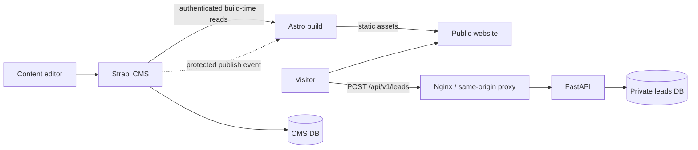

# LeadForge

**An SEO-first agency website and private lead-intake platform.**

> **Project status: documentation complete; application implementation not yet started.** This repository currently contains specifications and an implementation backlog. Screenshots, live URLs, CI badges, performance scores, and working setup commands will be added only after they have been verified.

LeadForge is a portfolio-oriented demonstration of a practical digital-agency workflow: editors publish services and case studies in a headless CMS; a fast static website presents that content to prospective clients; and a separate API securely receives business inquiries. The fictional public-facing demo brand is **Forma Studio**. Demo work and testimonials must never be represented as real client engagements.

## Product overview

| Concern | Solution |
|---|---|
| Public website | Astro 5 + TypeScript, static generation, SEO metadata |
| Content operations | Strapi 5, draft/publish, editorial admin |
| Lead capture | Python 3.12 + FastAPI, validation, abuse controls |
| Persistence | PostgreSQL 16; separate CMS and lead databases and roles |
| Data access | Build-time Strapi reads; same-origin `/api/v1/leads` POST |
| Delivery | Docker Compose for local backend services; Nginx proxy; GitHub Actions CI/CD planned |
| Visual system | `#171717` ink and `#F7F6F2` paper; editorial, restrained, responsive |

Versions above are **architecture targets**, not installed or verified package versions. Actual compatible patch versions and lockfiles must be resolved during implementation.

## Why this architecture?

- **Astro** serves fast, pre-rendered public pages with little browser JavaScript. CMS content is fetched during the build, not by every visitor.
- **Strapi** provides editorial content models, media, publishing workflows, and an admin interface without building a custom dashboard.
- **FastAPI** owns lead intake and validation; visitor submissions never write directly to the CMS or database.
- **PostgreSQL** stores CMS content and private lead records in logically separate databases with independent credentials.
- **A protected publish-to-build workflow** will rebuild and deploy the static site when Strapi content changes. A failed build must preserve the last successful deployment.

### Intended request flows



The diagram describes the **planned** topology, not deployed infrastructure. Final static-host and proxy routing arrangements remain an implementation decision gate.

## MVP scope

The planned public routes are `/`, `/services`, `/services/[slug]`, `/case-studies`, `/case-studies/[slug]`, `/contact`, and a 404 page. Services, case studies, testimonials, and site settings are managed through Strapi. The contact form submits a name, email, optional service, and message to FastAPI with input validation, honeypot handling, request limits, and a privacy notice.

Not in the MVP: a custom admin panel, AI content generation, CRM integration, subscriptions, multi-tenancy, Astro SSR, or analytics dashboards. These are intentionally excluded to keep the project focused and demonstrable.

## Repository structure

```text
leadforge/
├── README.md                    # Project overview and eventual runbook
├── TODO.md                      # Documentation completion checklist
├── docs/
│   ├── Architecture.md          # System boundaries and decisions
│   ├── PRD.md                   # User journeys and acceptance criteria
│   ├── ERD.md                   # Data model and ownership
│   ├── Stack.md                 # Dependencies and environment policy
│   ├── Design.md                # UI system and page blueprints
│   ├── TDD.md                   # Contracts and technical testing
│   ├── Implementation_plan.md   # Milestones and verification gates
│   └── Build_Prompt.md          # Coding-agent execution rules
├── frontend/                    # PLANNED: Astro application
├── cms/                         # PLANNED: Strapi application
├── api/                         # PLANNED: FastAPI application
└── infra/                       # PLANNED: Compose, Nginx, deploy configuration
```

`frontend/`, `cms/`, `api/`, and `infra/` are **not yet implemented**. Do not assume the planned paths exist in the current documentation bundle.

## Local setup — implementation pending

**Prerequisites (planned):** Node.js compatible with the resolved Astro/Strapi versions, Python 3.12, `uv`, Docker Engine and Compose, and Git. Verify runtime compatibility before locking versions.

After milestone M0 creates source code, lockfiles, Compose services, and `.env.example`, the intended developer workflow will be:

```bash
# Planned commands — NOT executable in the documentation-only repository yet
cp .env.example .env
# Fill development-only secrets; never commit .env

docker compose -f infra/docker-compose.yml up -d --build
docker compose -f infra/docker-compose.yml ps

cd frontend
npm ci
npm run build

cd ../api
uv sync --frozen
uv run pytest
```

Initial CMS administrator creation, database migration execution, content seeding, and local host/port mapping will be documented with **actual tested commands** once those services exist. No default credentials are supplied. Production secrets must be managed outside source control.

### Planned environment contract

| Component | Configuration | Exposure |
|---|---|---|
| FastAPI | `DATABASE_URL`, `APP_ENV`, `LOG_LEVEL`, `MAX_REQUEST_BYTES` | Server-only |
| CMS | Database credentials, Strapi app/API secrets, build-webhook secret | Server-only |
| Astro build | CMS base URL and restricted read credential, canonical site URL | Build-only; never bundle secrets into browser JS |
| Reverse proxy | Public site origin, upstream service address, TLS and request limits | Public edge only |

The exact `.env.example` keys must be reconciled against `docs/Stack.md` and `docs/TDD.md` during LF-003; this table is a conceptual overview, **not a complete ready-to-use `.env` file**.

## API contract (planned)

| Method | Path | Purpose |
|---|---|---|
| `POST` | `/api/v1/leads` | Validate and store a new lead; never return private lead records |
| `GET` | `/health/live` | Process liveness, independent of DB connectivity |
| `GET` | `/health/ready` | Database-backed readiness; return 503 when unavailable |

Use the **TDD's `/health/live` and `/health/ready` paths** as the canonical contract if an older architecture/stack summary mentions `/health` or `/ready`. A public `GET /api/v1/leads` is deliberately excluded.

## Development and verification

Work through `docs/Implementation_plan.md` in order:

| Milestone | Deliverable | Gate |
|---|---|---|
| M0 | Repo, dependency locks, environment and Compose foundation | G0: startup/configuration verified |
| M1 | Strapi content types, permissions, seed/publish flow | G1: content contract verified |
| M2 | FastAPI lead API, migrations, unit/integration tests | G2: private lead flow verified |
| M3 | Astro pages, editorial UI, SEO and accessibility | G3: static build verified |
| M4 | CMS-to-Astro and browser-to-API integration | G4: end-to-end demo verified |
| M5 | Security hardening, CI/CD and safe deployment | G5: tests and rollback verified |
| M6 | Real setup docs, screenshots, demo and portfolio handoff | G6: reproducible demo verified |

**Testing strategy (not yet executed):** Pytest + HTTPX for API behavior, PostgreSQL-backed integration tests, frontend lint/type checks and static build, content contract checks, accessibility/SEO review, Compose healthchecks, and a failed-build deployment safety test. No tests are claimed as passing at this stage.

## Design principles

LeadForge's demo site uses a two-color design system: **Ink `#171717`** and **Paper `#F7F6F2`**. Inspiration is drawn from the clarity and precision of established software companies, not copied assets or layouts. One font family (Inter), generous whitespace, strong typography, simple service rows, editorial case-study imagery, and accessible forms replace gradients, glowing decorations, fabricated metrics, and generic AI-template visuals. See [`docs/Design.md`](docs/Design.md).

## Security and privacy boundaries

Leads belong exclusively to the FastAPI service and private database; Strapi manages editorial content only. The intended system includes server-side validation, proxy-enforced rate limits, restricted CMS permissions, no publicly readable leads, secret isolation, and sanitized logs. A privacy/retention policy and deployment controls must be verified before any real customer data is collected. The documentation alone is **not** evidence of a production-secure system.

## Demo walkthrough (planned)

1. Create or update a **clearly fictional** service and case study in Strapi, then publish.
2. Trigger the protected static build and verify the published content appears on the site.
3. Navigate through services and case studies, checking metadata, canonical URLs, responsive layout and keyboard access.
4. Submit a test inquiry and confirm FastAPI validation, safe success/error messages and private PostgreSQL persistence.
5. Demonstrate that anonymous visitors cannot retrieve lead records and that a failed build cannot replace the last good deployment.

Add verified demo URL, repository URL, screenshots, CI results, Lighthouse findings, and exact commands only after implementation.

## Documentation and next action

- [`docs/Architecture.md`](docs/Architecture.md) — architectural authority.
- [`docs/PRD.md`](docs/PRD.md) — product scope and user-facing requirements.
- [`docs/ERD.md`](docs/ERD.md) — entities, constraints, and data ownership.
- [`docs/Stack.md`](docs/Stack.md) — target technology and dependency policy.
- [`docs/Design.md`](docs/Design.md) — visual and interaction specification.
- [`docs/TDD.md`](docs/TDD.md) — concrete technical contracts and verification matrix.
- [`docs/Implementation_plan.md`](docs/Implementation_plan.md) — work queue and milestone gates.
- [`docs/Build_Prompt.md`](docs/Build_Prompt.md) — agent instructions for implementation.

**Next:** Begin M0 from the implementation plan; treat all nine documents as a coordinated specification, verify assumptions against actual framework behavior, and update this README as features are proven to work.

---

*LeadForge is an independent portfolio concept; Forma Studio is a fictional demo identity. No real customer relationships or performance claims are implied.*
