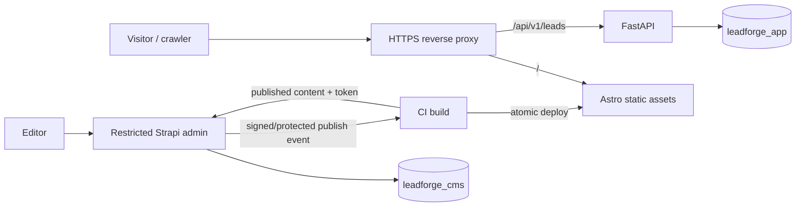

# LeadForge — Technology Stack & Dependency Policy

**Version:** 1.0  
**Status:** Proposed stack baseline; exact patch versions verified and frozen during implementation  
**Related documents:** `Architecture.md`, `PRD.md`, `ERD.md`  
**Scope:** One business per deployment; content-driven public website and private lead intake.

## 1. Decisions at a glance

| Layer | Choice | Version policy | Why |
|---|---|---|---|
| Frontend | Astro + TypeScript | Astro 5.x target; confirm current supported release and compatibility before installation | Static-first pages, dynamic routes, SEO, minimal JS |
| Styling | Tailwind CSS | Compatible current stable release, pinned in lockfile | Rapid responsive design; no heavy component framework |
| CMS | Strapi Community Edition | Strapi 5.x target; confirm supported Node range | Built-in admin, content modeling, draft/publish, REST API |
| CMS runtime | Node.js | Node 22 LTS target **subject to Strapi compatibility check** | Predictable long-term runtime |
| API | Python + FastAPI | Python 3.12; FastAPI compatible stable release, locked | Typed request validation and isolated lead service |
| API server | Uvicorn | Compatible stable release, locked | ASGI server |
| ORM / migration | SQLAlchemy 2.x + Alembic | Compatible stable releases, locked | Explicit ownership of private lead schema |
| Validation | Pydantic 2.x | Compatible stable release, locked | Typed lead payload and settings |
| Database | PostgreSQL | PostgreSQL 16 | Reliable persistence and isolated logical databases |
| Local orchestration | Docker Compose | Compose v2 plugin | One-command reproducible local environment |
| Reverse proxy | Nginx | Stable image pinned by digest for deployment | Same-origin `/api/v1/leads`, TLS termination, request limits |
| CI | GitHub Actions | Versioned actions pinned to commit SHA in production | Test and build gates |
| Static hosting | CDN/static host (provider TBD) | No provider commitment yet | Keep Astro static and independently deployable |
| Monitoring | Container logs + health checks | MVP | Enough for small deployment; no full observability stack |

**Important:** Target versions above are design decisions, **not assertions of the latest releases**. The implementation must check Astro/Strapi official compatibility tables, choose exact supported patch versions, and record them in lockfiles and container digests. Do not install `latest` in production or invent unverified patch numbers.

## 2. Architectural boundaries (non-negotiable)

1. `frontend/` is an Astro static site. Fetch **published** Strapi content at build time; no Strapi credentials in browser bundles.
2. `cms/` is Strapi only: SiteSettings, Service, CaseStudy, Testimonial, reusable SEO/CTA components and media. **Do not create a Strapi Lead collection**.
3. `api/` is FastAPI only: `POST /api/v1/leads`, `GET /health`, `GET /ready`; lead validation, abuse controls and persistence.
4. One PostgreSQL instance may serve two **separate databases** (`leadforge_cms`, `leadforge_app`) with different users. No cross-service SQL access.
5. Browser submits lead forms to a **same-origin reverse-proxied** FastAPI endpoint. Do not add Astro SSR solely for forms.
6. Strapi publishing triggers authenticated build/deploy automation. Failed builds must not replace the last good static site.
7. Single-business MVP: no tenant isolation, login for public users, custom CRM dashboard, Redis, queue broker or AI model.

## 3. Frontend dependencies and conventions

- `astro`, `typescript`, `@astrojs/sitemap` (verify adapter/package compatibility during installation).
- Tailwind CSS using its Astro-compatible integration path for the selected major versions; **do not assume an older `@astrojs/tailwind` integration is appropriate**.
- Use `.astro` components for Header, Footer, Hero, ServiceCard, CaseStudyCard, TestimonialCard, LeadForm, SEOHead.
- Pages: `/`, `/services/`, `/services/[slug]/`, `/case-studies/`, `/case-studies/[slug]/`, `/contact/`, `/privacy/`, `/404`.
- Use `getStaticPaths()` for collection routes; sanitize content fields and use safe, explicit rich-text rendering (never render untrusted raw HTML directly).
- Native HTML forms + lightweight client-side enhancement; server validation is authoritative.
- Use semantic HTML, labels, visible errors, keyboard navigation, reduced-motion support, responsive images and accessible contrast.
- SEO: canonical URLs, title/description, Open Graph, sitemap, robots.txt, correct 404 behavior, JSON-LD only when accurate.
- Environment: `STRAPI_URL`, `STRAPI_READ_TOKEN`, `PUBLIC_SITE_URL`; only `PUBLIC_` variables may be exposed to client code. The read token is build-time only.

## 4. Strapi CMS

**Content types:** SiteSettings (single), Service, CaseStudy, Testimonial; reusable SEO and CTA components. Follow `ERD.md` for fields and relationships.

- Use Strapi REST API with explicit `fields`, `filters`, `populate`, and publication-state behavior for the selected version.
- Editors use authenticated Strapi admin; public role has no write permissions. Prefer a scoped read-only API token for Astro build-time requests.
- Enable draft/publish and publish webhooks; keep webhook secret in the deployment environment.
- Media stored on a persistent volume for the MVP. Back up files **and** database; object storage is optional later.
- Strapi schema/content-type definitions live in Git; content is seeded through a documented script or supported import procedure.
- Do not hand-edit Strapi-managed database tables or apply Alembic to the CMS database.
- Verify admin access restrictions, CORS settings, upload limits and token rotation before production.

## 5. FastAPI and private leads

Suggested packages: `fastapi`, `uvicorn`, `pydantic-settings`, `sqlalchemy`, `psycopg` (v3 driver), `alembic`, `pytest`, `httpx`, `ruff`; `mypy` optional. Pin all via a reproducible Python lock mechanism (`uv.lock` recommended, or equivalent).

- Endpoint: `POST /api/v1/leads` with Pydantic schema (name, email, optional service slug, message, honeypot field).
- Return generic confirmation; avoid exposing whether a given email exists. Log request IDs, never raw messages or email addresses.
- Reject oversized payloads; validate lengths and formats; escape any lead content when exported or rendered.
- Implement rate limits at reverse proxy or another shared enforcement point; a per-process Python dictionary is **not** sufficient for multi-worker deployments.
- Apply honeypot, basic abuse protection and timeout controls; optional CAPTCHA only if abuse justifies it.
- Persistence: SQLAlchemy 2.x models in `leadforge_app`; Alembic migrations. `status` is private operator workflow metadata.
- Health: `/health` checks process; `/ready` checks DB reachability. No public lead-list endpoint.
- For MVP, operator inspects leads using restricted DB access/CLI export; do not build a dashboard.

## 6. PostgreSQL layout

- Container image: `postgres:16` **with a pinned patch/digest in release deployment**.
- Logical databases: `leadforge_cms`, `leadforge_app`; distinct least-privilege users.
- Initialize database roles with idempotent bootstrap SQL in `infra/postgres/init/` for first-run only.
- Never assume initialization scripts re-run on an existing persistent volume.
- Keep database ports private on the Docker network; no public `5432` mapping in production.
- Index and uniqueness constraints per `ERD.md`; migrations are reviewed and tested.
- Back up both DBs and Strapi uploads; document restore drill and retention policy.

## 7. Development and deployment topology



**Local:** Docker Compose runs PostgreSQL, Strapi, FastAPI and optionally Nginx; Astro can run on the host for fast HMR. Provide a documented full-container option or explicit host routing. Static builds must be possible from the local seeded CMS.

**Production MVP:** Static frontend on CDN/static host; Strapi and FastAPI in containers behind HTTPS. If the static host cannot reverse proxy `/api/v1/leads`, use an edge rewrite/proxy or a unified Nginx origin. Do **not** silently switch to a cross-origin public API; document the hosting choice in `Implementation_plan.md`.

**Webhook protection:** Strapi event should call a minimal authenticated receiver or provider-supported protected deploy hook. Never expose an unprotected GitHub workflow dispatch or repository token. Debounce duplicate events when supported.

## 8. CI/CD quality gates

1. Install dependencies using frozen Node and Python lockfiles.
2. Lint and typecheck Astro/TypeScript, Strapi and Python.
3. Run API unit/integration tests using isolated test database.
4. Run CMS API contract smoke tests with seeded content.
5. Build Astro against published CMS content; fail on missing required content or API errors.
6. Run page smoke tests: key routes, metadata, sitemap, accessibility checks, lead form.
7. Build and scan container images; validate `docker compose config`.
8. Deploy only if gates pass; retain rollback to last known-good static artifact and container image.

Prefer `npm ci` with committed `package-lock.json` (or use one consistently chosen package manager across Node workspaces), and `uv sync --frozen` for Python if using uv.

## 9. Environment variables (names only)

| Service | Variables | Exposure |
|---|---|---|
| Astro build | `STRAPI_URL`, `STRAPI_READ_TOKEN`, `PUBLIC_SITE_URL` | Read token: secret build-time only |
| Strapi | `HOST`, `PORT`, `APP_KEYS`, `API_TOKEN_SALT`, `ADMIN_JWT_SECRET`, `TRANSFER_TOKEN_SALT`, `JWT_SECRET`, `DATABASE_URL`, `WEBHOOK_SECRET` | Secrets server-side only; exact Strapi config mapping verified at implementation |
| FastAPI | `DATABASE_URL`, `APP_ENV`, `LOG_LEVEL`, `MAX_REQUEST_BYTES` | Server-side only |
| PostgreSQL | Database bootstrap names and role passwords | Secret manager / `.env` not committed |
| Proxy | Public hostname, TLS paths, upstream names | No credentials in frontend |

Commit `.env.example` with placeholders only. Never commit real `.env`, API keys, DB passwords or customer leads.

## 10. Local developer commands (intended contracts)

```bash
# Start persistent dependencies and backend services
 docker compose -f infra/docker-compose.yml up -d --build
# Inspect service status and logs
 docker compose -f infra/docker-compose.yml ps
 docker compose -f infra/docker-compose.yml logs --tail=100 api cms
# Build frontend after CMS seed/publish
 cd frontend && npm ci && npm run build
# Run API tests (from api/)
 uv sync --frozen && uv run pytest
```

These commands are **target interfaces**; corresponding Compose services, scripts and lockfiles will be created in the implementation phase. Do not represent them as currently working.

## 11. Version verification / lock checklist

Before implementation starts:

- [ ] Check official Astro documentation for supported Node versions and current supported Astro major.
- [ ] Check official Strapi v5 compatibility matrix for Node.js and PostgreSQL; confirm Node 22 is supported for selected patch.
- [ ] Verify Tailwind integration for the selected Astro/Tailwind major versions.
- [ ] Resolve and commit exact dependency versions via lockfiles; record `node --version`, `python --version`, `docker compose version`.
- [ ] Pin base images by digest for deployment; check security advisories.
- [ ] Select the production host and prove same-origin `/api/v1/leads` routing.
- [ ] Run `npm ci`, frozen Python sync, build, migrations, integration tests and smoke tests successfully.

**Authoritative exact versions:** `frontend/package-lock.json`, `cms/package-lock.json`, `api/uv.lock`, and Docker image digest references. This document describes the policy, not an invented snapshot of a working installation.

## 12. Explicit exclusions and deferred choices

No Redis, Kafka, Kubernetes, Next.js, custom admin UI, GraphQL, SSR Astro server, AI content generator, CRM integration, analytics warehouse or multi-tenant billing in MVP. Consider these only after functional acceptance criteria and demo deployment pass.

**Next document:** `Design.md` (visual system, component specifications and responsive behavior); then `TDD.md` for exact endpoint/schema/error contracts.
