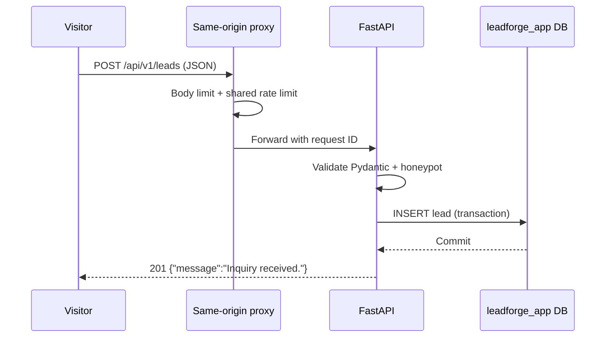

# LeadForge — Technical Design Document (TDD)

**Version:** 1.0  
**Status:** Implementation specification (not an assertion that code exists)  
**Depends on:** `Architecture.md`, `PRD.md`, `ERD.md`, `Stack.md`, `Design.md`  
**Scope:** Single-business, static-first agency site + private lead intake

## 1. Purpose and governing decisions

This document turns the approved MVP into implementable module, API, persistence, integration, and test contracts. When details conflict, resolve in this order: security/data ownership in Architecture and ERD; product acceptance in PRD; dependency policy in Stack; visual specification in Design; then this TDD. Record intentional changes as ADRs before implementation.

**Invariants:** Astro statically builds public pages from published Strapi content; Strapi owns marketing content only; FastAPI owns lead submissions; PostgreSQL uses two logically isolated databases; `/api/v1/leads` is same-origin; no custom CMS or lead dashboard; no public lead reads. Demo brands, client stories, and metrics must be explicitly fictional or verifiable.

## 2. Repository and module boundaries

```text
leadforge/
├── README.md
├── docs/{Architecture,Build_Prompt,Design,ERD,PRD,Stack,TDD,Implementation_plan}.md
├── frontend/
│   ├── src/
│   │   ├── components/{layout,ui,sections,forms,seo}/
│   │   ├── layouts/BaseLayout.astro
│   │   ├── lib/{strapi,content,seo,validation}/
│   │   ├── pages/{index,services/index,services/[slug],case-studies/index,case-studies/[slug],contact,404}.astro
│   │   └── styles/global.css
│   ├── public/{robots.txt,images}/
│   ├── astro.config.mjs
│   └── package-lock.json
├── cms/
│   ├── config/
│   ├── src/api/{site-setting,service,case-study,testimonial}/
│   ├── src/components/shared/{seo,cta}.json
│   ├── scripts/seed-demo.*
│   └── package-lock.json
├── api/
│   ├── app/
│   │   ├── main.py
│   │   ├── core/{config,logging,security}.py
│   │   ├── db/{session,models}.py
│   │   ├── leads/{router,schemas,service,repository}.py
│   │   └── health/router.py
│   ├── alembic/versions/
│   ├── tests/{unit,integration}/
│   ├── pyproject.toml
│   └── uv.lock
├── infra/
│   ├── docker-compose.yml
│   ├── postgres/init/
│   ├── nginx/
│   └── scripts/
└── .github/workflows/
```

Names represent target paths; implementers may add files but must preserve ownership boundaries. No frontend import of FastAPI database models and no CMS direct access to lead records.

## 3. Runtime interaction contracts

### 3.1 Content publication (build time)

1. Editor authenticates to Strapi Admin and creates/publishes SiteSettings, Services, CaseStudies and Testimonials.
2. Protected build process reads Strapi REST using `STRAPI_READ_TOKEN`, never a `PUBLIC_`-prefixed variable.
3. Frontend adapter normalizes Strapi 5 document responses to typed view models; it explicitly requests media/relations/components with `populate` and filters for published content.
4. `getStaticPaths()` creates detail routes for published unique slugs only; missing required content fails build with a useful non-secret error.
5. Successful CI build deploys immutable static assets; failed build preserves last good deployment.
6. Protected CMS webhook triggers a rebuild after publish/update/unpublish. Do not expose an unauthenticated build endpoint.

**Build resilience:** set bounded HTTP timeouts, retry only transient read failures with limited backoff, and fail rather than publishing incomplete content. Use pagination to retrieve all published entries, not just the first API page.

### 3.2 Lead submission (runtime)



Astro contact form uses progressive enhancement: submit via browser `fetch` to same-origin `/api/v1/leads`; show inline loading, success and error states. For JavaScript-disabled visitors, provide an explicit contact-email fallback, because a static Astro deployment does not natively handle server-side HTML form POSTs. Never claim full no-JS form submission support without a separately implemented server handler.

## 4. Strapi 5 schema and read contracts

### 4.1 CMS content types

| Type | Kind | Fields | Relations |
|---|---|---|---|
| `site-setting` | Single | `brandName`, `logo`, `contactEmail`, `defaultSeo`, `socialLinks` | None |
| `service` | Collection | `title`, `slug`, `summary`, `body`, `heroImage`, `seo` | Many case studies/testimonials (inverse optional) |
| `case-study` | Collection | `title`, `slug`, `clientLabel`, `challenge`, `solution`, `outcomes`, `coverImage`, `seo` | Optional related service |
| `testimonial` | Collection | `authorName`, `role`, `company`, `quote` | Optional related service |
| `shared.seo` | Component | `title`, `description`, `ogImage` | Embedded |
| `shared.cta` | Component | `label`, `href` | Optional embedded component; not mandatory MVP |

Strapi Draft & Publish is enabled for collection types; `publishedAt` is Strapi-managed. For exact field constraints, use ERD. Configure read-only API token with the narrowest collection permissions. Never expose draft content, Strapi admin credentials, or token to browser bundles.

### 4.2 Build-time fetcher interface

```ts
export type ServicePage = {
  slug: string;
  title: string;
  summary: string;
  body: unknown; // validated Strapi Blocks document, rendered with an allowlist
  heroImage?: { url: string; alternativeText: string };
  seo: { title: string; description: string; ogImage?: string };
};

export interface ContentGateway {
  getSettings(): Promise<SiteSettings>;
  listServices(): Promise<ServicePage[]>;
  getServiceBySlug(slug: string): Promise<ServicePage | null>;
  listCaseStudies(): Promise<CaseStudyPage[]>;
  getCaseStudyBySlug(slug: string): Promise<CaseStudyPage | null>;
  listTestimonials(): Promise<Testimonial[]>;
}
```

`SiteSettings`, `CaseStudyPage`, and `Testimonial` must be defined as strict normalized types matching ERD; avoid passing raw Strapi response objects into `.astro` components. Strapi 5 uses `documentId` for document identity; public routes use stable `slug`, not numeric IDs or `documentId`. Handle Strapi REST envelopes, missing optional media, absolute/relative media URLs, pagination, and relation population explicitly. Use `URL` to resolve media against the configured CMS origin; only permit approved schemes/hosts.

**Fetcher error taxonomy:** `ContentFetchError` (network/timeouts), `ContentContractError` (schema mismatch), `ContentNotFoundError` (required single type absent). Log route/type and request ID, not tokens or full authenticated URLs.

### 4.3 Safe rich text

Use a compatible Strapi Blocks renderer or a strict block-to-HTML mapping. Allowed blocks: paragraph, headings h2–h4, lists, links, bold/italic, quote, and images with alt text. Never use raw `set:html` on untrusted CMS content. External links use `rel="noopener noreferrer"` when opening a new tab. Unsupported blocks produce a build warning/error, not unsafe HTML.

## 5. Astro frontend implementation

### 5.1 Routes and ownership

| Route | Data source | Primary behavior |
|---|---|---|
| `/` | SiteSettings, featured Services, selected Testimonials | Hero, services, proof, CTA |
| `/services` | Published Services | Service index |
| `/services/[slug]` | Published Service | SEO detail, CTA |
| `/case-studies` | Published CaseStudies | Work index |
| `/case-studies/[slug]` | Published CaseStudy | Narrative detail, truthful outcomes |
| `/contact` | SiteSettings, Services | Inquiry form |
| `/404` | Static | Helpful recovery navigation |

No SSR is needed for these pages. Add an `/about` page only if PRD explicitly makes it P0 or P1; it is not part of the seven-page design baseline.

### 5.2 UI component responsibilities

- `BaseLayout.astro`: global structure, header/footer, skip link, metadata slots.
- `SeoHead.astro`: canonical, description, Open Graph, robots directives, JSON-LD only for truthful structured data.
- `Container.astro`, `SectionHeading.astro`, `ButtonLink.astro`, `Divider.astro`: reusable primitives.
- `ServiceRow.astro`, `CaseStudyPreview.astro`, `TestimonialQuote.astro`: editorial modules, not generic floating cards.
- `LeadForm.astro`: accessible inputs, honeypot, client submission state and inline error announcement.

**Visual rules (from Design):** exactly two solid design colors, Ink `#171717` and Paper `#F7F6F2`; no gradient, purple accent, glassmorphism, shadow-heavy cards, fake logos, decorative AI imagery, or motion without purpose. Use semantic typography, 12-column desktop layout, restrained dividers, generous whitespace and responsive spacing. Opacity variations are permitted; do not introduce a third brand color. Respect `prefers-reduced-motion`.

### 5.3 SEO and accessibility

Use `@astrojs/sitemap` or the compatible integration verified during implementation, canonical base `PUBLIC_SITE_URL`, stable clean slugs, unique metadata, descriptive alt text, semantic headings, keyboard navigation, visible focus, and adequate contrast. Ensure sitemap excludes unpublished content. Validate static page HTML rather than relying only on component unit tests.

## 6. FastAPI lead intake contract

### 6.1 Endpoint

`POST /api/v1/leads` accepts `application/json` only. Request:

```json
{
  "name": "Jane Doe",
  "email": "jane@example.com",
  "service_slug": "web-development",
  "message": "I would like to discuss a new website project.",
  "website": ""
}
```

Field constraints:

| Field | Required | Validation |
|---|---|---|
| `name` | Yes | Trim; 2–120 characters |
| `email` | Yes | Valid email, max 254 characters; normalize domain, preserve local-part semantics |
| `service_slug` | No | Nullable; slug pattern `^[a-z0-9]+(?:-[a-z0-9]+)*$`, max 120 characters |
| `message` | Yes | Trim; 10–5000 characters |
| `website` | No | Honeypot; must be empty; never persisted |

Reject unknown JSON fields (Pydantic `extra="forbid"`) and oversized requests. Implement email validation with a suitable package such as `email-validator` via Pydantic's `EmailStr`; record dependency in lockfile. Do not perform synchronous runtime lookup of service slugs against Strapi; CMS availability must not block lead capture. Optional service slug is a historical snapshot.

### 6.2 Responses

| HTTP | Condition | Public response |
|---|---|---|
| `201` | Insert committed | `{"message":"Inquiry received."}` |
| `400` | Malformed JSON / invalid content type as appropriate | Generic request error |
| `413` | Body exceeds configured limit | Generic payload-too-large error |
| `422` | Schema invalid | Safe field-level validation errors, no sensitive echo |
| `429` | Rate limit reached | Generic retry-later error; `Retry-After` when supported |
| `503` | Database unavailable | Generic temporarily unavailable error |

For a non-empty honeypot, respond with a generic `201` and **do not persist** the lead, to avoid confirming the spam rule. Keep status/error shape consistent; document FastAPI's default 422 shape or override it deliberately, and test the chosen contract. Database exceptions must never leak DSNs, SQL statements, emails or messages.

### 6.3 API layers

`router.py` handles HTTP/DI; `schemas.py` handles Pydantic input/output; `service.py` enforces business rules; `repository.py` performs persistence; `models.py` declares SQLAlchemy model; `session.py` owns scoped DB sessions. Avoid generic repository frameworks or event buses for a single insert workflow.

**Transaction:** one request → one DB session → one insert → commit → response. Roll back on exception. Use timezone-aware UTC timestamps. A retry after uncertain network failure can create duplicate inquiries; MVP does not claim exactly-once semantics or deduplicate by email. Add idempotency only if product requirements justify it.

### 6.4 Health endpoints

- `GET /health/live` returns `200` when the application process is alive; no DB dependency.
- `GET /health/ready` returns `200` only when DB connectivity succeeds, otherwise `503`.

Use these exact paths consistently in Compose, monitoring and tests; do not mix with `/health` and `/ready` aliases unless explicitly added and documented.

## 7. Database and migration design

One PostgreSQL 16 instance with databases `leadforge_cms` and `leadforge_app`, distinct least-privilege users. Strapi alone manages CMS schema. FastAPI alone manages `leadforge_app` via Alembic; no runtime `create_all()` in production.

Private `leads` columns: `id UUID PK`, `name VARCHAR(120)`, `email VARCHAR(254)`, `service_slug VARCHAR(120) NULL`, `message TEXT`, `status VARCHAR(20) DEFAULT 'new'` constrained to `new|contacted|closed`, `created_at TIMESTAMPTZ`, `updated_at TIMESTAMPTZ`. Add `ix_leads_created_at` descending. No unique email constraint. Do not store honeypot. See ERD for detailed nullability.

**Migrations:** initial revision creates table/check/index; `alembic upgrade head` executes as a controlled deployment step before readiness checks; subsequent schema changes use new revisions and a documented rollback path. Use a separate test DB or disposable PostgreSQL container for integration tests.

## 8. Infrastructure and environment contracts

### 8.1 Compose services

- `db`: PostgreSQL 16, persistent named volume, private network, healthcheck.
- `cms`: Strapi 5, waits for healthy DB, persistent uploads, environment secrets.
- `api`: FastAPI, waits for DB, runs migrations via explicit controlled step, readiness healthcheck.
- `proxy` (optional locally, required for same-origin integration test): routes static site and `/api/v1/leads` to API, enforces body-size and rate limits.
- `frontend`: optional local dev container; static build is the release artifact.

Bootstrap two DBs/users via first-run init SQL, with documentation that initialization is **not rerun** for an existing volume. Never publish PostgreSQL to the internet.

### 8.2 Environment names

| Scope | Required variables |
|---|---|
| Astro build | `STRAPI_URL`, `STRAPI_READ_TOKEN`, `PUBLIC_SITE_URL` |
| CMS | `APP_KEYS`, `API_TOKEN_SALT`, `ADMIN_JWT_SECRET`, `TRANSFER_TOKEN_SALT`, `JWT_SECRET`, `DATABASE_URL`, `WEBHOOK_SECRET` |
| API | `DATABASE_URL`, `APP_ENV`, `LOG_LEVEL`, `MAX_REQUEST_BYTES` |
| DB/bootstrap | DB names, usernames, passwords from noncommitted environment/secret source |

Provide `.env.example` placeholders. Do not include secrets in screenshots, logs, committed fixtures or frontend `PUBLIC_` variables. Runtime config must fail fast when required values are missing.

### 8.3 Deployment routing decision gate

Production must demonstrate same-origin `/api/v1/leads` using a capable CDN edge proxy or unified Nginx origin. Static-only hosts without proxy routing are not sufficient alone. Keep CMS admin on a separate restricted hostname; build worker must reach CMS over authenticated HTTPS. Persist uploads and back up both DBs.

## 9. Security and privacy design

- Shared reverse-proxy rate limit with explicit trusted-client-IP configuration; don't trust arbitrary `X-Forwarded-For` headers. A process-local counter is only a local-development fallback.
- Request size limits at proxy and API; Pydantic bounds and content type checks; no raw HTML rendering of submissions.
- CORS restricted to the real site origin if required; same-origin deployment avoids broad CORS allowances.
- Restrict Strapi public role; read token is build-only; admin login protected and uploads constrained.
- Protected webhook receiver: verify provider signature/shared secret with constant-time comparison; prevent replay when supported; rate-limit and debounce duplicate builds.
- Public form includes privacy notice and link to an actual policy before real customer data is collected; define retention/deletion procedure and access control.
- Logs contain request ID, route, status, latency and coarse error code only; no raw lead PII, authorization headers or connection strings.
- Operator-only lead review through restricted DB/CLI export; any CSV export must escape spreadsheet formula injection and be access-controlled.

## 10. Error handling and observability

FastAPI uses structured logs and a per-request correlation ID. Return safe, stable error messages. CMS build adapter records type/slug and error category without credentials. Nginx access logs must avoid request bodies. Collect process uptime, HTTP status counts, latency, DB readiness and build success/failure. Alert on sustained 5xx or repeated failed deployments. Do not claim zero downtime without tested rollout and rollback.

## 11. Testing strategy and acceptance matrix

| ID | Level | Test | Pass condition |
|---|---|---|---|
| T-01 | Unit | Pydantic field boundaries | Valid inputs accepted; empty/oversized/invalid inputs return 422 |
| T-02 | Unit | Honeypot | Non-empty honeypot yields generic response; zero inserts |
| T-03 | Integration | POST lead to disposable PostgreSQL | 201 and exactly one row with default `new` |
| T-04 | Integration | Database unavailable | 503 without stack trace or PII leakage |
| T-05 | Integration | Rate limit | 429 beyond configured threshold, no extra rows |
| T-06 | Integration | Migration | Fresh DB upgrades to head; required constraints/index exist |
| T-07 | Contract | Strapi response normalization | Missing required fields fail; optional media safe |
| T-08 | Integration | Draft/published | Only published services/cases become static pages |
| T-09 | Build | Astro static generation | Home, indexes, detail pages, contact, 404 build successfully |
| T-10 | SEO | Generated HTML | Canonical, unique metadata, sitemap and robots verified |
| T-11 | Accessibility | Keyboard/form states | Labels, focus, announcements, contrast, mobile layout pass |
| T-12 | E2E | Browser inquiry | Success/error states and DB insertion verified through proxy |
| T-13 | Security | Permissions | Anonymous Strapi draft/admin access denied; no public lead GET |
| T-14 | Security | Secrets | No CMS token or DB credentials in static assets or logs |
| T-15 | Infrastructure | Compose and readiness | All required services healthy; DB not publicly exposed |
| T-16 | CI/CD | Build failure | Failed CMS fetch/test blocks deployment; previous site remains live |

Use `pytest` + `httpx` for API, disposable PostgreSQL for persistence, Astro build/HTML assertions, and one browser E2E suite (Playwright optional but recommended). Mock only external boundaries in unit tests; don't mock database behavior in persistence integration tests.

## 12. Delivery sequence and technical gates

1. **Foundation:** repo, lockfiles, `.env.example`, Compose DB, bootstrap roles, healthchecks.
2. **CMS:** Strapi content types, narrow API token, fixtures, published-content contract tests.
3. **API:** Pydantic schemas, migration, lead insert, health, rate limit, tests.
4. **Frontend:** design tokens, shared components, content gateway, static routes, SEO, form states.
5. **Integration:** same-origin proxy, real CMS-to-build and form-to-DB tests.
6. **Hardening:** permissions, secrets scan, accessibility, performance, backup/restore rehearsal.
7. **Delivery:** CI gates, protected webhook, production routing proof, demo content, README.

The detailed ordered tasks, estimates and completion gates belong in `Implementation_plan.md`.

## 13. Open implementation verification items

- Verify current compatible Node/Strapi/Astro/Tailwind versions against official docs before installing; commit actual lockfiles and image digests.
- Verify Strapi 5 exact REST response and relation-populate syntax against running instance; don't assume Strapi 4 envelopes.
- Choose and test static host/edge proxy capable of same-origin API routing.
- Confirm deployment webhook provider and signature verification scheme.
- Decide production lead retention period, privacy notice text, and authorized export operator.
- Confirm whether homepage includes Testimonials and whether any empty sections are hidden rather than filled with fake claims.

## 14. TDD definition of done

Implementation is complete only when all P0 product criteria and T-01 through T-16 pass; secrets and leads remain private; published CMS content appears on rebuilt static pages; the public inquiry flow persists a valid lead; the UI follows the strict two-color Design spec; documentation reflects tested commands rather than aspirational examples; and a reproducible demo can be run from a clean checkout.
